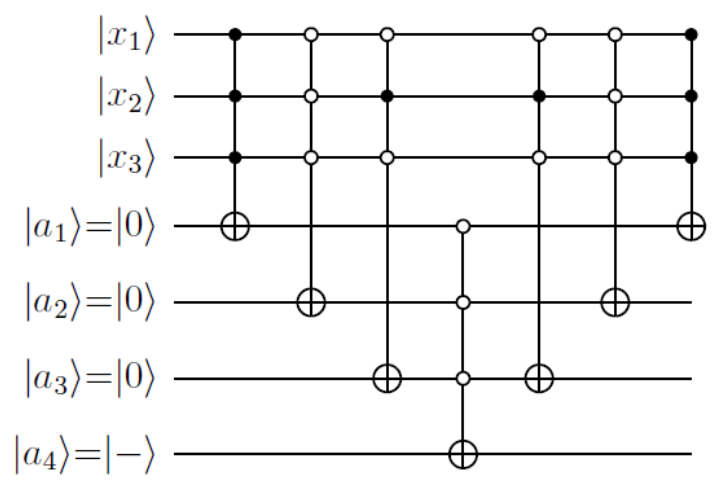
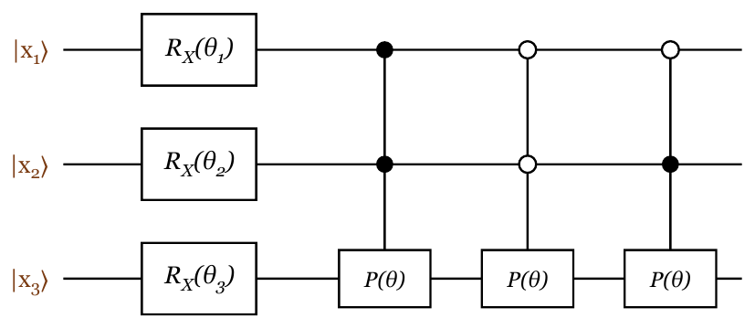
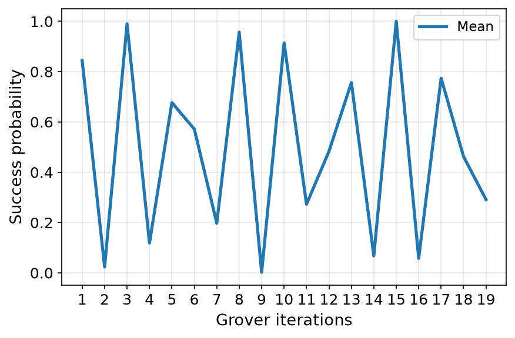
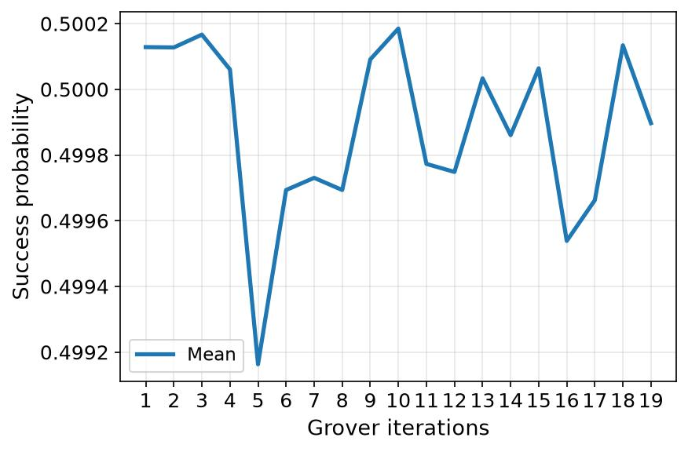
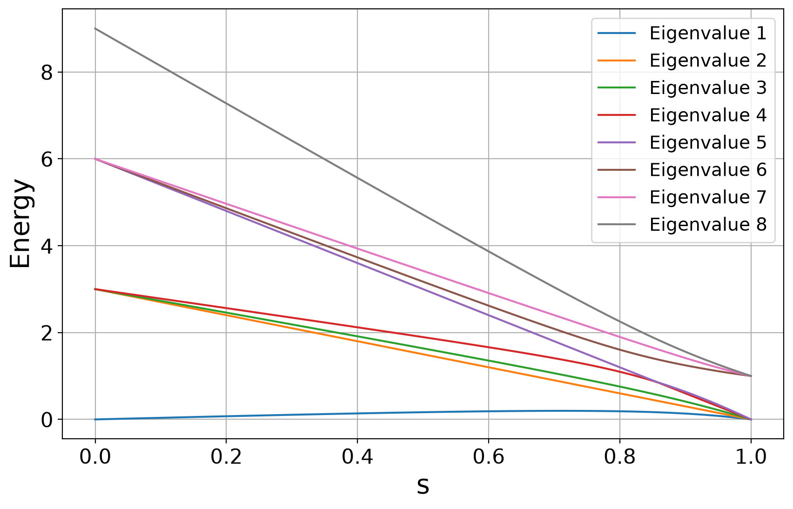
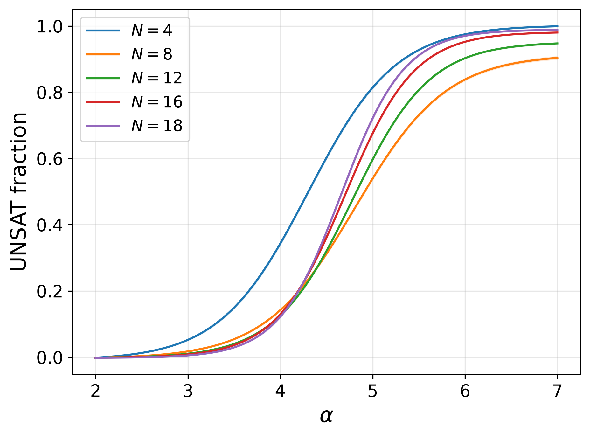
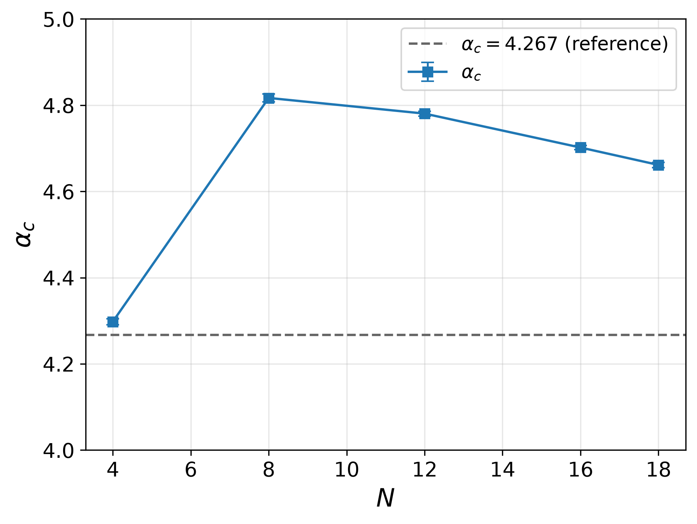

# Random 3-SAT with quantum algorithms: Grover search and digitized adiabatic computation

Code for the Bachelor's thesis *Resolución del problema 3-SAT mediante computación cuántica* (Physics, Universidad de Zaragoza, 2025–2026). It implements Grover's algorithm for isolated instances and a digitized adiabatic algorithm to study the 3-SAT phase transition and estimate the satisfiability threshold α<sub>c</sub> for up to 18 variables. All circuits are simulated (ideal, noiseless) with Qiskit Aer; no quantum hardware is used.

## Key results

- **Grover (N = 3):** the first high peak of the success probability is at 3 iterations for instances with 3 solutions and at 4 for 7 solutions; with 4 solutions (half of the states) it stays at 0.5.
- **Phase transition:** fitting a sigmoid to the UNSAT fraction gives α<sub>c</sub> between 4.66 and 4.82 for N = 8–18 (N<sub>t</sub> = 15), decreasing with N towards the reference value 4.267; for N = 18, α<sub>c</sub> = 4.661 ± 0.006.
- **Trotter resolution:** going from N<sub>t</sub> = 15 to 30 changes α<sub>c</sub> by at most 0.04 (under 1 %), with no systematic direction.

## 1. The problem

A 3-SAT instance is a Boolean formula with N variables and M clauses of exactly three literals, and the question is whether some assignment satisfies every clause. Random instances follow the standard random model: each clause picks 3 distinct variables uniformly at random and negates each with probability 1/2, with all clauses distinct.

As α = M/N grows, the fraction of unsatisfiable (UNSAT) instances goes from 0 to 1 around α<sub>c</sub> ≈ 4.267 (Marino, Parisi and Ricci-Tersenghi, Nat. Commun. 7, 12996, 2016), and the transition sharpens as N increases. Instances close to α<sub>c</sub> are the hardest.

## 2. Implemented approaches

### Grover search

The oracle uses N variable qubits, one ancilla per clause and one master ancilla prepared in |−⟩ (N + M + 1 qubits in total):

1. For each clause, a multi-controlled X flips the clause ancilla when the assignment *violates* the clause; an X gate then turns this into "ancilla = 1 ⇔ clause satisfied".
2. A multi-controlled X from all clause ancillas onto the master ancilla flips, by phase kickback, the sign of the assignments that satisfy every clause.
3. Step 1 is undone and the diffusion operator (inversion about the mean) is applied.

<p align="center"></p>

*Oracle for the instance (¬x<sub>1</sub> ∨ ¬x<sub>2</sub> ∨ ¬x<sub>3</sub>) ∧ (x<sub>1</sub> ∨ x<sub>2</sub> ∨ x<sub>3</sub>) ∧ (x<sub>1</sub> ∨ ¬x<sub>2</sub> ∨ x<sub>3</sub>), one clause ancilla per clause and the master ancilla at the bottom. Open circles are controls on |0⟩; the code implements the same operation with an extra X on each clause ancilla.*

Grover's algorithm solves isolated instances well. It is not suited to scanning the phase transition: the optimal number of iterations depends on the number of solutions, which is unknown beforehand, and the measured states have to be checked classically.

### Digitized adiabatic computation

The system evolves under H(s) = (1 − s) H<sub>B</sub> + s H<sub>P</sub>, with s from 0 to 1:

- **H<sub>P</sub>** is the sum over clauses of the projector onto the single assignment that violates the clause, so its ground states (energy 0) are exactly the solutions.
- **H<sub>B</sub>** = Σ<sub>i</sub> d<sub>i</sub> (1 − X<sub>i</sub>) / 2, with d<sub>i</sub> the number of clauses containing variable *i*. Its ground state |+⟩<sup>⊗N</sup> is trivial to prepare.

The evolution is Trotterized. The parameter s takes N<sub>s</sub> + 1 values k / N<sub>s</sub> (k = 0 … N<sub>s</sub>), and for each one N<sub>t</sub> Trotter steps of duration T / (N<sub>s</sub> N<sub>t</sub>) are applied: one RX rotation per qubit (H<sub>B</sub>) and one multi-controlled phase gate per clause (H<sub>P</sub>). The total evolution time is therefore T (1 + 1/N<sub>s</sub>), 0.5 % above T for N<sub>s</sub> = 200. Finally all qubits are measured. In the code N<sub>s</sub> is called `N_D`.

<p align="center"></p>

*One Trotter step for the same instance: RX rotations (H<sub>B</sub>) followed by one multi-controlled phase gate per clause (H<sub>P</sub>).*

An instance is declared **SAT** if at least one measured bit string satisfies the formula (checked classically) and **UNSAT** otherwise. Since the number of shots is finite, a satisfiable instance whose solutions are never observed would be counted as UNSAT: the UNSAT fraction is an empirical estimate, cross-checked against exhaustive search for small N (see Section 4).

## 3. Repository structure

```
src/
  sat_instances.py          random instance generation, classical checking, brute-force solutions
  grover_3sat.py            Grover circuit + experiment: success probability vs iterations (N = 3)
  adiabatic_3sat.py         adiabatic circuit, full version (also compares with exhaustive search)
  adiabatic_3sat_lite.py    adiabatic circuit, lite version (p(UNSAT) and energy only)
analysis/
  plot_grover.py            success-probability curves from the Grover results
  fit_alpha_c.py            four-parameter sigmoid fit of p(UNSAT) vs α and extraction of α_c
  energy_spectrum.py        exact spectrum of H(s) for the example instance
data/                       aggregated results behind Tables 1 and 2
docs/figures/               figures used in this README
```

A formula is a list of clauses, each a list of `(variable, negated)` pairs. In bit strings, character *i* is the value of variable *i*. Core function names (`generar_formula_logica`, `resolver_formula_3_SAT`, …) are in Spanish to match Annex A of the thesis.

## 4. Methodology

**Grover.** N = 3 variables. Instances are grouped by their number of solutions M<sub>s</sub> (for N = K = 3, M distinct clauses give M<sub>s</sub> = 8 − M). Each curve is the mean over 200 random instances of the probability that a measurement returns a true solution, for 1–19 Grover iterations, with 10<sup>8</sup> shots per circuit.

**Adiabatic.** T = 100, N<sub>s</sub> = 200 and N<sub>t</sub> = 15 (and 30 as a check), for N = 4, 8, 12, 16 and 18. For each N, a grid of 17–24 values of α between 2.0 and 7.0 is simulated; for each α, between 1000 and 6000 random instances are solved and the fraction of UNSAT instances is recorded. The full version also compares the solutions found with an exhaustive search, which is only feasible for small N; the logs kept cover N = 4 and N = 8, where they matched in 21 000 of 21 000 and 8 494 of 8 500 instances (in each mismatch, a single solution was not measured).

A four-parameter sigmoid

p<sub>UNSAT</sub>(α) = A / (1 + exp(−k (α − α<sub>c</sub>))) + B

is fitted by weighted least squares, using the binomial standard error of each point as its weight. A and B are free to account for the finite range of α. α<sub>c</sub> is the fitted midpoint and its error comes from the covariance matrix of the fit.

## 5. Results

### Grover (N = 3)

Success probability against the number of iterations, averaged over 200 instances. With 3 solutions the first high peak is at 3 iterations; with 7 solutions it is at 4. With 4 solutions, half of the 2<sup>3</sup> states, the probability stays at 0.5: there is no net amplification.

<p>


</p>

### Spectrum of H(s)

For the example instance, with 5 solutions out of 8, the five degenerate ground states at s = 1 are those solutions.

<p align="center"></p>

### Phase transition and α<sub>c</sub>

Fitted p<sub>UNSAT</sub> curves for N<sub>t</sub> = 15 (left) and fitted α<sub>c</sub> against N (right); the dashed line is the reference value 4.267.

<p>


</p>

| N | samples per α | α<sub>c</sub> (N<sub>t</sub> = 15) |
|--:|--:|:--|
| 4 | 3000 | 4.298 ± 0.007 |
| 8 | 3000 | 4.817 ± 0.009 |
| 12 | 6000 | 4.780 ± 0.006 |
| 16 | 6000 | 4.702 ± 0.005 |
| 18 | 3000 | 4.661 ± 0.006 |

| N | samples per α | α<sub>c</sub> (N<sub>t</sub> = 30) |
|--:|--:|:--|
| 4 | 3000 | 4.297 ± 0.007 |
| 8 | 2000 | 4.856 ± 0.013 |
| 12 | 1000 | 4.761 ± 0.014 |
| 16 | 1000 | 4.721 ± 0.011 |

- The curves get steeper as N grows (except N = 4), as expected for a transition that tends to a step function, and those with N ≥ 8 cross close to the literature value of α<sub>c</sub>.
- For N ≥ 8 the fitted α<sub>c</sub> decreases with N towards the reference value; the deviations are of the size of the finite-size corrections reported by Crawford and Auton (about 0.57 at N = 16). Four sizes are too few to claim convergence. N = 4 lies closest to the reference, which is attributed to N = 4 being too small to be representative.
- Doubling N<sub>t</sub> from 15 to 30 changes α<sub>c</sub> by at most 0.04 (under 1 %), with no systematic direction.
- N<sub>s</sub> = 200 was used throughout. How N<sub>s</sub> must scale with N, and the minimum gap g<sub>min</sub>(α, N) near α<sub>c</sub>, are natural next steps.

## 6. Installation and usage

Requires Python 3 and the packages in `requirements.txt` (Qiskit, Qiskit Aer, NumPy, SciPy, Matplotlib).

```bash
python -m venv .venv
# Linux/macOS: source .venv/bin/activate      Windows (PowerShell): .\.venv\Scripts\Activate.ps1
pip install -r requirements.txt
```

Run everything from the repository root. Generated files go to `results/` (ignored by git). Use `--no-plots` / `--no-show` on machines without a display, and `--help` for the options of each script.

```bash
# Grover: sanity check on the example instance + success probability vs iterations (about 20 s)
python src/grover_3sat.py --seed 1
python analysis/plot_grover.py --no-show

# Adiabatic, quick runs on N = 4 (about 1 minute each)
python src/adiabatic_3sat_lite.py --no-plots --seed 2
python src/adiabatic_3sat.py --no-plots --seed 1

# Spectrum of H(s) for the example instance
python analysis/energy_spectrum.py --no-show

# Reproduce Tables 1 and 2 from the data in data/
python analysis/fit_alpha_c.py data --Nt 15 --no-show
python analysis/fit_alpha_c.py data --Nt 30 --no-show
```

The Grover sanity check prints a success probability close to 0.98 for 2 iterations, and `fit_alpha_c.py` prints the α<sub>c</sub> values of the tables above.

## 7. Reproducing the results

- **Tables 1 and 2** are reproduced by `fit_alpha_c.py` from the files in `data/`.
- **Grover curves:** `python src/grover_3sat.py --instances 200 --clauses 1 4 5 --shots 1000000` gives the curves of the thesis, which used 10<sup>8</sup> shots (about 11 GB of RAM per circuit in Aer). The success probability only depends on the number of solutions, so 10<sup>6</sup> shots give the same shape.
- **α<sub>c</sub> data:** generating the datasets from scratch takes days (N = 4–8) to months (N = 16) of CPU time on a single core: one instance at α = 4.25 takes about 12 s for N = 8 and 160 s for N = 16. This is why the aggregated results are provided in `data/`.

The files in `data/` are named `N_<N>_T_<T>_Nt_<Nt>_ND_<Ns>_M_<samples>.json`. The analysis uses the key `unsat_por_alpha`, which maps each α to the number of instances (`total`) and how many were UNSAT (`unsat`); the other keys are auxiliary statistics written by the scripts.

## 8. Thesis

D. Vallejo Miranda, *Resolución del problema 3-SAT mediante computación cuántica*, Bachelor's thesis in Physics, Universidad de Zaragoza, 2025–2026 (in Spanish). Supervisors: José Vicente García Esteve and Alberto Aleta Casas.

[Thesis in the University of Zaragoza repository](https://zaguan.unizar.es/record/180602)

The thesis contains the derivations, the full bibliography and the annex with the core code.
